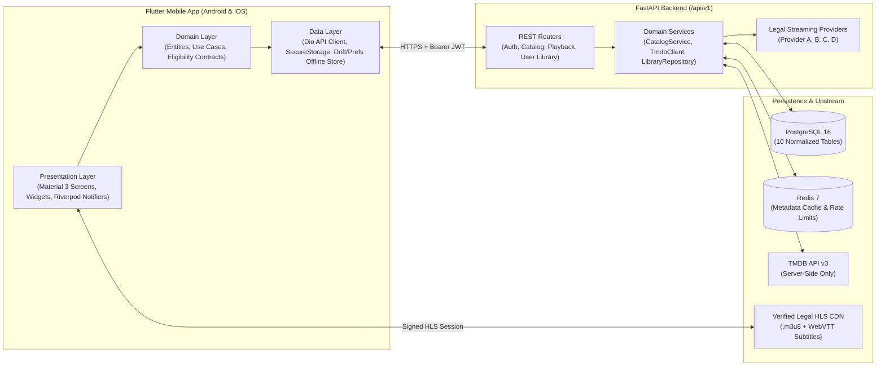

# Nam Cinema — Software & Streaming Architecture

## 1. Architectural Overview

**Nam Cinema** (*Your Cinema. Anywhere.*) is architected as a feature-first Clean Architecture cross-platform Flutter application paired with an asynchronous Python FastAPI backend.



---

## 2. Clean Architecture Layers (Mobile)

1. **Presentation Layer (`lib/features/*/presentation`)**:
   - Stateless and Consumer widgets styled with the Nam Cinema dark palette (`#08090D` primary background, `#E50935` crimson accent, `#7C4DFF` violet accent).
   - State managed via Riverpod (`StateNotifierProvider`, `FutureProvider`) with explicit loading skeletons, empty states, and retryable error states.
2. **Domain Layer (`lib/features/*/domain`)**:
   - Immutable domain models (`MediaItem`, `TitleAvailabilityModel`, `WatchHistoryModel`, `AuthUser`, `SubtitleCue`) with strict separation between TMDB metadata IDs (`tmdbId`) and internal playable asset UUIDs (`playableAssetId`).
   - Enforces the playback eligibility rule: **Never display an internal Play button unless `isDirectlyPlayable == true` and a verified `playableAssetId` is present.**
3. **Data Layer (`lib/features/*/data` & `lib/core/*`)**:
   - `ApiClient` wraps `Dio` with automatic `Bearer` access-token injection and transparent 401 refresh-token rotation via `/api/v1/auth/refresh`.
   - `SecureTokenStorage` persists JWT access and refresh tokens in encrypted platform keychains (`flutter_secure_storage`).
   - `LocalDatabase` (Drift) and `LocalCacheStore` (SharedPreferences) persist recent searches, offline watchlist snapshots,watch history, and subtitle preferences.

---

## 3. Legal Video Source Architecture (`StreamingProvider` Protocol)

All video sources implement the common `StreamingProvider` protocol in `backend/app/providers/streaming.py`:

```python
class StreamingProvider(Protocol):
    async def get_availability(self, title_id: str, region: str) -> list[dict]: ...
    async def create_playback_session(self, asset_id: str, user_id: str) -> dict: ...
```

- **Provider A (`LicensedHlsProvider`)**: Serves licensed adaptive-bitrate HLS (`.m3u8`) streams with expiring HMAC-SHA256 signed session parameters (`nc_sid`, `nc_exp`, `nc_sig`), WebVTT subtitle tracks (`vi`, `en`), and audio track metadata.
- **Provider B (`SelfHostedLibraryProvider`)**: Serves developer-owned or self-hosted HLS manifests registered in the `video_assets` and `video_sources` tables. No open/arbitrary URL proxy is exposed.
- **Provider C (`PublicDemoContentProvider`)**: Pre-seeded with verified Creative Commons Attribution 3.0 (`CC-BY 3.0`) open movies from the Blender Foundation (*Big Buck Bunny*, *Tears of Steel*) and Apple's official HLS authoring sample stream, verified to return HTTP `200 OK` from CDN.
- **Provider D (`ExternalWatchProvider`)**: Queries `provider_mappings` and TMDB `watch/providers` by region (`VN`, `US`) to display legal external platforms (e.g., Netflix, Apple TV) with deep links. Calling `create_playback_session` on `ExternalWatchProvider` raises `AuthorizationError (403)` so external subscriptions are never misrepresented as internal streams.
